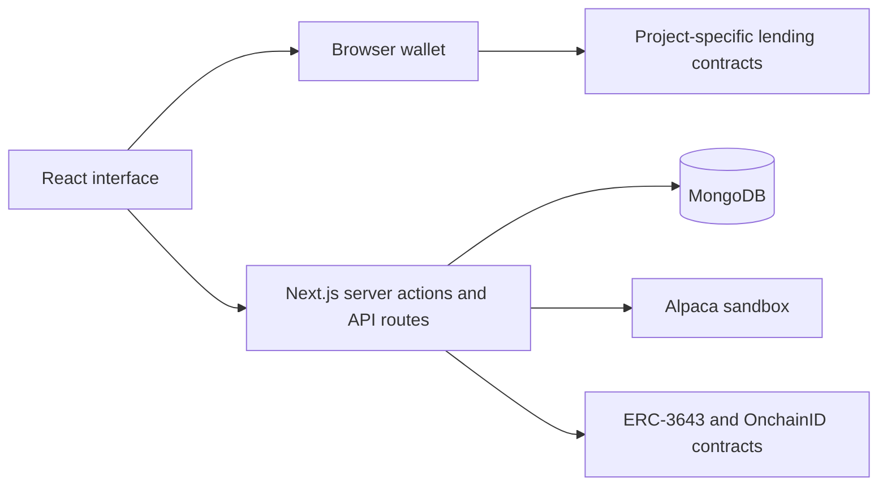

# RWA Stock Lending — Hackathon PoC

A full-stack integration prototype exploring how a wallet-based application can connect brokerage sandbox data, tokenized assets, on-chain identity and lending workflows.

**Status:** Hackathon proof of concept. Use synthetic data, disposable test wallets and sandbox/testnet services only. This is not a production financial service or a security-audited deployment.

## Contribution and scope

My contribution focuses on the application integration layer: connecting the React interface, Next.js backend, MongoDB records and existing smart-contract interfaces into a demonstration workflow.

ERC-3643 / OnchainID and the lending contracts were developed by other contributors or upstream projects. This repository does not claim authorship of those protocols or their contract implementations. The project-specific lending interface should not be assumed to be interchangeable with a standard Compound deployment.

| Area | Integration explored |
| --- | --- |
| Wallet experience | Connect a browser wallet, handle account/network changes and refresh application state. |
| Identity and claims | Call existing OnchainID / ERC-3643 interfaces to create identities, register them and attach claims; persist identity metadata in MongoDB. |
| Brokerage sandbox | Connect signup and account/position data to the Alpaca Broker sandbox. |
| Tokenization | Check application and identity configuration before calling the token contract; record the transaction hash and mint history. |
| Lending | Wire collateral supply/withdrawal, borrowing and repayment controls to the project-specific lending client; handle approvals, confirmation and refreshed balances. |
| Self integration | Explore the Self QR verification experience and its connection to application claim records. |

These describe the code's integration scope, not a guarantee that historical test deployments or external services remain available.

## Architecture



**Stack:** Next.js App Router, React, TypeScript, Tailwind CSS, MongoDB and Ethers v6.

The browser wallet signs lending transactions. Server-side test accounts perform configured identity and token operations. MongoDB stores application records and transaction references; those records are not independent proof of reserves, legal ownership or final settlement.

## Code guide

- [`src/context/web3-provider.tsx`](src/context/web3-provider.tsx): wallet connection and shared application state.
- [`src/app/actions`](src/app/actions): server-side integration and persistence.
- [`src/lib/erc3643-client.ts`](src/lib/erc3643-client.ts): identity, claim, registry and token calls.
- [`src/lib/compound-client.ts`](src/lib/compound-client.ts): the lending contract adapter used by the UI.
- [`src/lib/alpaca-client.ts`](src/lib/alpaca-client.ts): brokerage and market-data API calls.
- [`src/lib/db`](src/lib/db): database connection and application schemas.
- [`src/app/lending/page.tsx`](src/app/lending/page.tsx): lending forms, transaction state and balances.

## Local exploration

You need Node.js 22 LTS, npm, a local MongoDB instance and an EVM browser wallet. External flows also require your own sandbox credentials and compatible testnet contracts with the appropriate roles, claim topics and trusted issuers configured.

1. Copy `.env.example` to `.env.local` and fill only the settings needed for the flow you want to explore.
2. Use a local MongoDB URI. The application selects the `rwa_lending` database.
3. Configure server-only credentials separately from the public contract addresses. Use matching network and token settings across the frontend and backend.
4. Install dependencies and start the development server:

   ```sh
   npm ci
   npm run dev -- --hostname 127.0.0.1
   ```

Open `http://127.0.0.1:3000`. The example configuration contains no usable credentials, so it is not a one-command, fully provisioned demo. Historical contract-address defaults are examples, not maintained deployment configuration; review and override them before connecting a wallet.

On `main`, contract deployment sources are maintained outside this application repository. The `compound-test` branch retains earlier contract experiments. Legacy Hardhat commands in `package.json` are not a complete deployment workflow; consult the relevant contract repository instead.

## Demonstration boundaries

- Brokerage calls use a sandbox by default. A mint transaction does not prove that real shares have been purchased, reserved or legally assigned to a token holder.
- Identity records and verification callbacks demonstrate integration, not a complete server-verified KYC/AML or authentication system. A connected wallet address alone is not proof of control.
- The lending UI depends on the exact deployed contract interface, token units and network configuration. It is not evidence of a live or audited Compound market.
- Real-asset redemption, settlement and reconciliation are outside the completed application scope.
- Before any public deployment, authentication/authorization, independent verification, dependency updates, privacy controls and failure recovery would need separate implementation and review. Do not submit real personal data or use accounts holding real assets.

## Keeping configuration private

Keep private keys, API credentials, authenticated RPC URLs and database credentials in `.env.local`, never in source files or README examples. `NEXT_PUBLIC_*` values are exposed to the browser and must contain public configuration only. Never reuse a test wallet or key for real assets.

Install [Gitleaks](https://github.com/gitleaks/gitleaks) 8.25 or later and enable the repository's local pre-commit check:

```sh
git config core.hooksPath .githooks
gitleaks git --log-opts="--all --full-history" --redact=100 --ignore-gitleaks-allow
```

The hook rejects staged environment files other than `.env.example` and scans staged changes for secrets. It must be enabled in each clone and is not a substitute for code review or credential revocation. The scanner configuration keeps the default rules and narrowly excludes public Ethereum token-address false positives, not private keys.

If you have a clone from before the history cleanup, make a fresh clone instead of merging or pushing the old history. Preserve any unpublished work separately and inspect it for secrets before reapplying it. A history rewrite cannot remove copies already held in other clones or forks.

## Related implementations and attribution

- [ERC-3643 / tokenized-stock contracts](https://github.com/RonShih/Tokenized-Stock)
- [Lending contracts used by the hackathon project](https://github.com/herochen11/comet_rwa_hackathon)
- [Self integration workshop](https://github.com/johnnylin9708/workshop)
- [OnchainID](https://github.com/onchain-id/solidity)

See [LICENSE](LICENSE) for this repository's license. Referenced projects retain their own licenses and attribution requirements.
